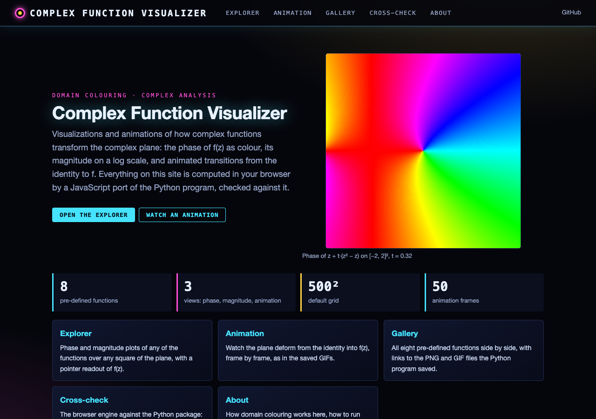
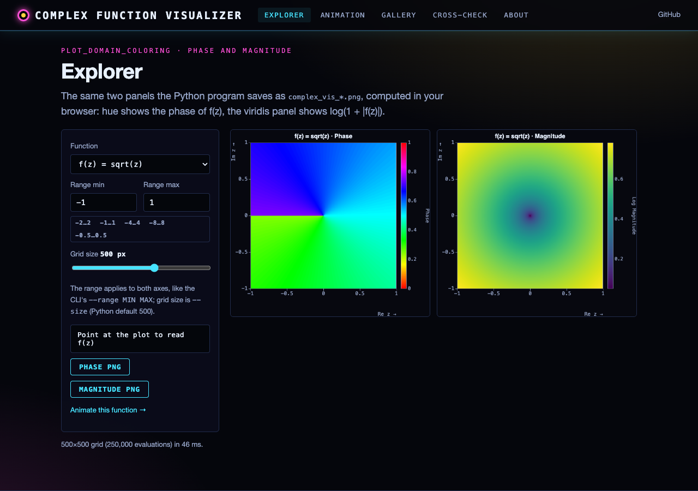
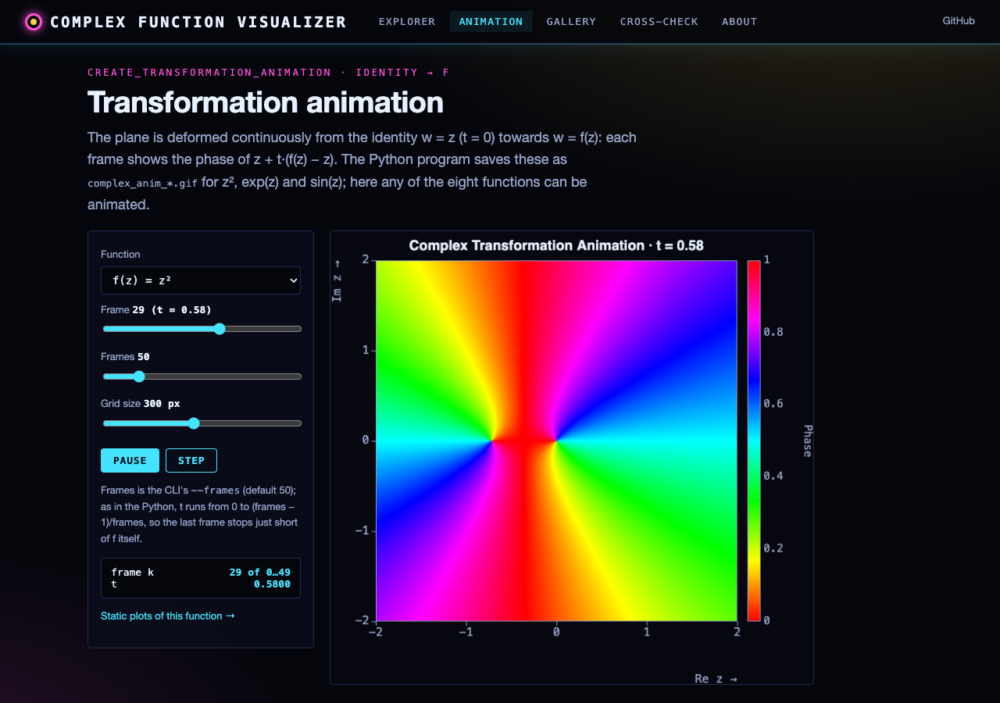
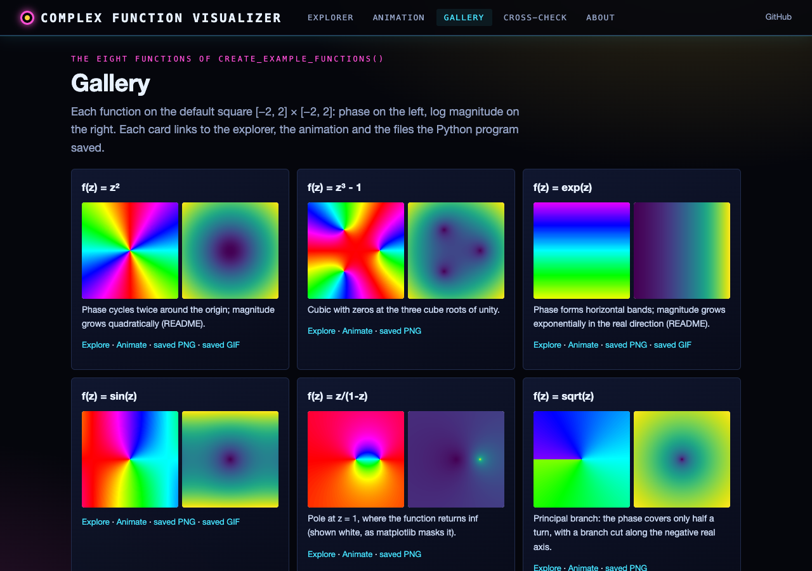

# Complex Function Visualizer

A Python tool for creating beautiful visualizations and animations of complex function transformations. This program provides insights into how complex functions transform the complex plane through domain coloring and animated transitions.

## Features

- Domain coloring visualizations of complex functions
- Phase and magnitude visualizations in separate plots
- Animated transformations showing how functions map the complex plane
- Custom HSV-based colormap for intuitive phase visualization
- Support for a wide range of complex functions
- Generates both static images (PNG) and animations (GIF)

## Installation

1. Clone this repository:
```bash
git clone [repository-url]
cd complex-function-visualizer
```

2. Install the required dependencies:
```bash
pip install numpy matplotlib
```

## Usage

Run the main script:
```bash
python complex_visualizer.py
```

The program will generate:
- Static visualizations for all example functions (saved as PNG files)
- Animations for selected transformations (saved as GIF files)
- Real-time display of all visualizations

## Included Functions

The visualizer comes with several pre-defined complex functions:
- `f(z) = z²` (Basic quadratic function)
- `f(z) = z³ - 1` (Cubic function with roots of unity)
- `f(z) = exp(z)` (Complex exponential)
- `f(z) = sin(z)` (Complex sine)
- `f(z) = z/(1-z)` (Rational function)
- `f(z) = sqrt(z)` (Complex square root)
- `f(z) = z·exp(z)` (Product function)
- `f(z) = ln(1+z)` (Complex logarithm)

## Customization

You can easily add new functions or modify existing ones:

```python
def create_example_functions():
    return [
        (lambda z: your_function(z), "f(z) = your_function_description"),
        # Add more functions here
    ]
```

### Parameters to Adjust

- `size`: Resolution of the visualization (default: 500)
- `x_range` and `y_range`: Range of the complex plane to visualize
- `frames`: Number of frames in animations (default: 50)

## Output Files

The program generates two types of files:
1. Static visualizations: `complex_vis_[function_name].png`
2. Animations: `complex_anim_[function_name].gif`

## Visualization Details

### Phase Plot
- Shows the argument (angle) of the complex output
- Uses a custom HSV colormap for continuous color transitions
- Full cycle of colors represents 2π radians (fixed scale 0..1 for arg/(2π) + 0.5)
- Imaginary axis points up (images use `origin='lower'`)

### Magnitude Plot
- Shows the absolute value of the complex output
- Uses logarithmic scaling for better visibility
- Viridis colormap for clear magnitude differences

## Examples

Here's how the visualizations look for different functions:

1. For `f(z) = z²`:
   - Phase plot shows color cycling twice around the origin
   - Magnitude plot shows quadratic growth

2. For `f(z) = exp(z)`:
   - Phase plot shows horizontal color bands
   - Magnitude plot shows exponential growth in the real direction

## Web interface

**Live site: https://gddickinson.github.io/complex-function-visualization/** (static, runs entirely in the browser)

The web version is the visualizer itself: `complex_visualizer/web/static/complex_engine.js` ports the eight functions,
the grid, the transform, the animation formula and the matplotlib colour lookup to JavaScript, and draws on a canvas.

- **Explorer**: phase and log-magnitude plots of any function over any square range and grid size, with a pointer
  readout of z and f(z), PNG download.
- **Animation**: the identity-to-f transformation, frame by frame (frames, grid size, play/pause/step).
- **Gallery**: all eight functions side by side, linking to the PNG/GIF files saved in this repository.
- **Cross-check**: the JS engine compared with `ComplexVisualizer.transform_complex` run by NumPy, grid by grid.

| | |
|---|---|
|  |  |
|  |  |

### Run the web app

```bash
pip install -r requirements-web.txt
python run_web.py                      # http://127.0.0.1:8152
python -m pytest -q tests/test_web.py  # API, static build, JS engine vs Python (needs node for the engine test)
python scripts/build_static.py         # export the static site to site/ (GitHub Pages builds this on push to main)
```

The local app adds Python-computed cross-checks on any grid. The JS engine is tested against reference values made by
the Python package (`python scripts/make_engine_fixture.py --write` regenerates `tests/fixtures/engine_fixture.json`).

## Contributing

Feel free to contribute by:
- Adding new complex functions
- Improving visualization techniques
- Enhancing the animation system
- Adding new features or visualizations

## License

This project is licensed under the MIT License - see the LICENSE file for details.

## Acknowledgments

- Inspired by the visual beauty of complex analysis
- Built using NumPy and Matplotlib
- Domain coloring techniques based on mathematical visualization research

---
*Built with AI assistance from [Claude (Anthropic)](https://claude.com/).*
